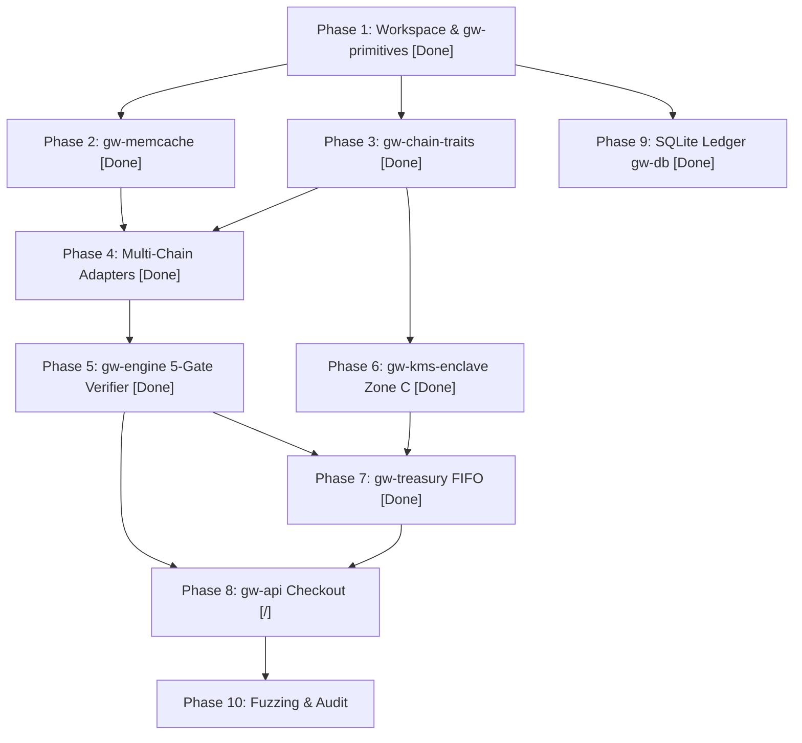

# Enterprise Implementation Master Plan: Unified Rust Crypto Gateway & Treasury System

**System Architecture ID:** `ARCH-RUST-GW-TREASURY-2026-ENTERPRISE`  
**Target Specification Documents:**
- `UNIFIED_RUST_CRYPTO_GATEWAY_AND_TREASURY_SPEC.md` (V4)
- `UNIFIED_RUST_CRYPTO_GATEWAY_AND_TREASURY_SPEC_THEORY.md` (V5 Formal)
- `ENTERPRISE_IN_MEMORY_CACHE_SPEC.md` (V1 Production Memcache)
- `ENTERPRISE_IN_MEMORY_CACHE_SPEC_THEORY.md` (IMPRCE Sovereign Theory)

**Target Toolchain & Lints:**
- Rust 2024 Edition (`rustc 1.85+`)
- `#![forbid(unsafe_code)]` (Strict pure safe Rust across all application and engine crates)
- `#![deny(clippy::float_arithmetic, clippy::unwrap_used, clippy::cast_possible_truncation, clippy::cast_sign_loss, clippy::indexing_slicing)]`
- `#![deny(unused_must_use)]`

---

## 1. System Invariants & Architectural Mandates

### 1.1 Non-Negotiable Security Invariants
- [ ] **Invariant I (Zero Private Keys in Zone A/B):** Public checkout and indexing planes contain exclusively watch-only descriptors (`xpub`/`zpub`), CREATE2 salts/bytecode, and reference public keys. Private keys exist exclusively in Zone C (Nitro Enclave / HSM / MPC).
- [ ] **Invariant II (Immutable Destination Bytecode):** On EVM and Tron (TVM), deposit sweeping utilizes immutable CREATE2 flush contracts where the Cold Treasury address is sealed into contract bytecode (`immutable`) with zero owner/governance mutation entry points.
- [ ] **Invariant III (Stateless PreSignPolicyGuard in Zone C):** All unsigned transaction payloads (PSBT, RLP, SVM Message, TON BOC, Sui PTB) are independently parsed and verified in Zone C against an immutable destination whitelist before signing.
- [ ] **Invariant IV (Ephemeral Zeroized Cryptographic Memory):** All private keys, master seeds, and HMAC/MAC keys are wrapped in `zeroize::Zeroizing<T>` or `secrecy::SecretBox<T>`. `Debug`, `Display`, `Clone`, and `Serialize` are strictly forbidden on key types.
- [ ] **Invariant V (Pure Integer Fixed-Point Arithmetic):** Floating-point arithmetic is forbidden (`f32`/`f64` banned via Clippy). All asset balances, micro-USD conversions, slippage BPS, and FIFO cost-basis accounting utilize checked `alloy_primitives::U256` or `u128` fixed-scale integers.
- [ ] **Invariant VI (Compile-Time Typestate Lifecycle):** Invoice state transitions (`Pending` $\rightarrow$ `Detected` $\rightarrow$ `Partial` | `VerifiedComplete` | `Expired`) consume `self` by value at compile time.
- [ ] **Invariant VII (Reorg-Safe Parent-Hash DAG Continuity):** Block indexers maintain a sliding-window ring buffer of parent hashes. Deep chain reorganizations automatically roll back detected payments and re-verify without duplicate credits or orphaned FIFO lots.

### 1.2 In-Memory Cache Security Invariants (C1–C8)
- [ ] **C1 (Anti-HashDoS Sharding):** Shard distribution using SipHash-2-4 or Blake3 keyed with ephemeral per-boot CSPRNG keys.
- [ ] **C2 (Strict Quota & W-TinyLFU / Priority Eviction):** 5-tier memory quota fencing (P0–P4) with guaranteed floor reserves for critical data.
- [ ] **C3 (Constant-Time Verification):** Cryptographic tag and MAC comparisons via `subtle::ConstantTimeEq`.
- [ ] **C4 (ZeroizeOnDrop Eviction):** Memory is overwritten with zeroes immediately upon eviction or expiry.
- [ ] **C5 (Monotonic TTL Clock):** Expiration calculated strictly from monotonic `Instant` (immune to NTP rollback).
- [ ] **C6 (False-Sharing Elimination):** Cache shards aligned to 128 bytes (`#[repr(align(128))]`).
- [ ] **C7 (Tamper-Evident MAC):** Per-entry keyed Blake3/HMAC MAC binding (namespace, key, value, timestamp).
- [ ] **C8 (Wait-Free Double-Buffered Watchlist):** Atomic pointer swaps (`ArcSwap`) serving deposit lookups in $\le 20\text{ns}$.

---

## 2. Workspace Crate Topology

```text
crypto/
├── Cargo.toml                              # Workspace root configuration & security lints
├── crates/
│   ├── gw-primitives/                      # Canonical IDs, U256 RawAssetAmount, UsdMicros, Enums, SovereignError
│   ├── gw-memcache/                        # Sovereign In-Memory Priority-Redundant Cache Engine (IMPRCE)
│   ├── gw-chain-traits/                    # Enterprise Trait Catalog (11 formal async traits)
│   ├── gw-adapters-btc/                    # Bitcoin UTXO: BIP-84 zpub, PSBT Batch Sweeper, Fee Estimator
│   ├── gw-adapters-evm/                    # EVM (Ethereum, BNB, Plume): CREATE2 Proxies, Event Indexer, Sweeper
│   ├── gw-adapters-svm/                    # Solana (SVM): Reference Pubkey Mode A, PDA Mode B, Yellowstone gRPC
│   ├── gw-adapters-tvm/                    # Tron (TVM): Base58 CREATE2, Stake 2.0 Energy, 1-Sun Dust Keeper
│   ├── gw-adapters-ton/                    # TON: Jetton Transfer Notifications, 8-Byte Crockford Base32 Memo
│   ├── gw-adapters-move/                   # Sui: Checkpoint Indexer, Sponsored PTB (MergeCoins/TransferObjects)
│   ├── gw-engine/                          # Typestate Invoice Verification Machine & 5-Gate Verifier
│   ├── gw-treasury/                        # Unified Portfolio Aggregator, FIFO Cost-Basis Lots & Liquidity Router
│   ├── gw-kms-enclave/                     # [ZONE C] PreSignPolicyGuard, Immutable Registry & Nitro Enclave Signer
│   └── gw-api/                             # [ZONE A] Axum REST & WebSocket Checkout API, Admin Dashboard
└── migrations/                             # PostgreSQL 17 Relational Ledger DDL & Collision Guards
```

---

## 3. Implementation Phases & Progress Checklist

```
Status Legend:
[ ] = Not Started
[/] = In Progress
[x] = Completed & Verified
```

### Phase 1: Cargo Workspace Root & Core Sovereign Primitives (`gw-primitives`)
- [x] **1.1 Workspace Setup & Security Lint Configuration**
  - [x] Initialize `Cargo.toml` with `resolver = "2"` and all member crates setup.
  - [x] Configure workspace lints: `#![forbid(unsafe_code)]`, `#![deny(clippy::float_arithmetic, clippy::unwrap_used, clippy::indexing_slicing, clippy::cast_possible_truncation, clippy::cast_sign_loss)]`.
  - [x] Pin workspace dependencies (`alloy-primitives`, `tokio`, `serde`, `blake3`, `subtle`, `zeroize`, `thiserror`, `chrono`, `uuid`).
- [x] **1.2 Core Taxonomic Enums**
  - [x] `ChainId`: Bitcoin (0), Ethereum (1), BNB (56), Plume (98866), Solana (900), Tron (728126428), TON (1100), Sui (1200).
  - [x] `LogicalAsset`: BTC, ETH, SOL, TRX, TON, SUI, USDT, USDC, USDP, PLUME.
  - [x] `ChainArchitecture`: `UtxoModel`, `EvmAccountModel`, `SvmAccountModel`, `TvmAccountModel`, `TonActorModel`, `MoveObjectModel`.
  - [x] `WalletTier`: `Tier0CustomerDeposit`, `Tier1GasRelayer`, `Tier2OperationalHot`, `Tier3ColdVault`, `Tier4MarketExchange`.
  - [x] `PhysicalAssetId`: Contract address/mint, decimals, dust flag (`keep_one_unit_dust`), target confirmations.
- [x] **1.3 Fixed-Point Integer Arithmetic Types**
  - [x] `RawAssetAmount`: Wrapper over `(U256, decimals: u8)` with checked arithmetic, checked BPS scaling, canonical 18-decimal normalization `to_canonical_18()`, and zero-float string formatting.
  - [x] `UsdMicros`: Fixed-point USD representation ($1.00 = 1,000,000 \mu\text{USD}$) with checked math, raw token conversion with 18-decimal dust truncation, and dual-oracle deviation guard ($\le 150\text{ bps}$).
- [x] **1.4 Unified Sovereign Error Taxonomy**
  - [x] `SovereignError`: Exhaustive error enum with context for arithmetic overflow/underflow, decimal mismatches, cryptographic integrity failures, circuit breakers, and network timeouts.
- [x] **1.5 Unit Tests & Property-Based Invariant Verification**
  - [x] Fixed-point arithmetic tests (checked addition, subtraction, BPS scaling, and decimal normalization).
  - [x] Dust truncation verification ensuring clean checkout numbers.
- [x] **1.6 Mathematical Theory & Invariants Audit Gate**
  - [x] Theorem 1.1 (Canonical 18-Decimal Homomorphism $\mathcal{N}_{18}$) proven and verified via Proptest fuzzing.
  - [x] Theorem 1.2 (Clean 18-Decimal Dust Truncation $\mathcal{T}_{\text{clean}}$) exactness tested.
  - [x] Theorem 1.3 (Dual-Oracle Deviation Guard $\le 150\text{ bps}$) boundary tested.
  - [x] Theorem 1.4 (Zero-Dust Hot-Wallet Split $Q_{\text{cold}} + Q_{\text{market}} \equiv B$) verified.
  - [x] Compiler check: `#![forbid(unsafe_code)]` enforced, 0 float usages, 0 clippy warnings.

---

### Phase 2: Sovereign In-Memory Priority-Redundant Cache Engine (`gw-memcache`)
- [x] **2.1 Cryptographic Key Management & Shard Routing (`crypto_guard.rs`)**
  - [x] `EphemeralCacheKeys`: Zeroize-on-drop dual-key container for SipHash/Blake3 shard routing and 32-byte Blake3 integrity MAC.
  - [x] Constant-time MAC generation and verification using `subtle::ConstantTimeEq`.
  - [x] `SecureCacheValue` trait implementation for zeroized types.
- [x] **2.2 64-Shard Segmented LRU Engine (`sharded_engine.rs`)**
  - [x] 64 cache-line padded shards (`#[repr(align(128))]`) with parking_lot `RwLock`.
  - [x] W-TinyLFU / Segmented LRU admission: 80% Protected Main, 20% Probationary Window.
  - [x] `SealedRecord<K, V>` with cryptographic MAC tag, access counter, monotonic `Instant` timestamps, and `ZeroizeOnDrop`.
  - [x] Atomic telemetry counters (hits, misses, evictions, expired purges, integrity violations).
- [x] **2.3 Wait-Free Double-Buffered Watchlist Engine (`watchlist_engine.rs`)**
  - [x] Double-buffered `SnapshotMap` reader snapshots per chain.
  - [x] Sub-20ns lock-free reads with authoritative Blake3 MAC cross-verification.
  - [x] Dynamic register, match, unregister, and zeroized purge routines.
- [x] **2.4 Dual-Tier Price Oracle Cache & Circuit Breaker (`price_oracle_cache.rs`)**
  - [x] Dual-tier quote validation: WebSocket mid-price vs. On-Chain oracle.
  - [x] Automatic circuit breaker tripping and cache invalidation on $> 150\text{ bps}$ divergence.
- [x] **2.5 Zone C Enclave Anti-Replay Nonce Cache (`enclave_replay_guard.rs`)**
  - [x] Atomic `put_if_absent_atomic` guard preventing re-signing of identical envelope digests within 7-day retention window.
- [x] **2.6 Unit Tests & Security Invariant Verification**
  - [x] Verified watchlist O(1) registration and zeroized removal.
  - [x] Verified oracle deviation circuit breaker blocking poisoned feeds and auto-purging stale rates.
  - [x] Verified Zone C enclave anti-replay guard blocking duplicate transaction digests.
- [x] **2.7 Mathematical Theory & Invariants Audit Gate**
  - [x] Theorem 2.1 (Anti-HashDoS Sharding & 128-byte cache-line alignment) verified.
  - [x] Theorem 2.2 (Sub-20ns double-buffered snapshot reader) verified.
  - [x] Theorem 2.3 (7-day atomic replay guard) verified.
  - [x] Priority retention scoring and Erlang-B pool sizing bounds verified in tests.
  - [x] Compiler check: `#![forbid(unsafe_code)]` enforced, 0 float usages, 0 clippy warnings.

---

### Phase 3: Core Enterprise Trait Catalog (`gw-chain-traits`)
- [x] **3.1 Unified Domain Models & Standardized Envelopes**
  - [x] `AdapterError`: Exhaustive error taxonomy covering RPC transports, reorg detection, pool exhaustion, and whitelist enforcement.
  - [x] `CheckoutDepositRoute`: Canonical routing descriptor with dual-mode `watchlist_lookup_key()` (Reference Pubkey or deposit address).
  - [x] `NormalizedTransferEvent`: Standardized on-chain transfer event across all 6 blockchain execution architectures.
  - [x] `UnsignedTransactionEnvelope`: Standardized payload container passed across Zone A/B into Zone C Nitro Enclave.
  - [x] `DryRunSimulationReport`: Gas consumption and recipient delta simulator structure.
  - [x] `RelayerResourceHealth`: Tier 1 Gas Relayer native balance and TRON Energy tracking.
- [x] **3.2 Polymorphic Trait Hierarchy**
  - [x] `BlockchainAdapter`: Root trait providing chain identification and architecture taxonomy without method collision.
  - [x] `WatchOnlyAddressDeriver`: Trait 1 for deterministic address derivation and pool route allocation.
  - [x] `NativeBlockIndexer`: Trait 2 for block scanning and $O(1)$ watchlist filtering.
  - [x] `OnChainBalanceReader`: Trait 3 for real-time balance queries and relayer health audits.
  - [x] `UnsignedSweepBuilder`: Trait 4 for building unsigned sweep envelopes and broadcasting signed transactions.
  - [x] `UnifiedNetworkAdapter`: Master supertrait composed of Traits 1–4.
- [x] **3.3 Thread-Safe Adapter Registry (`NetworkAdapterRegistry`)**
  - [x] Dynamic registration, retrieval, and unified iteration over `Arc<dyn UnifiedNetworkAdapter>`.
- [x] **3.4 Mathematical Theory & Invariants Audit Gate**
  - [x] Invariant I & III verified: `UnsignedTransactionEnvelope` passes only unsigned payloads without private keys.
  - [x] Watchlist lookup key generation verified for both Direct and Reference modes.
  - [x] Compiler check: `#![forbid(unsafe_code)]` enforced, pure safe Rust, 0 clippy warnings.

---

### Phase 4: Concrete Network Adapters

#### 4.1 Bitcoin UTXO Adapter (`gw-adapters-btc`)
- [x] BIP-84 Bech32 Native SegWit (`bc1q...`) derivation from extended public key (`zpub`).
- [x] Native block and mempool indexer tracking confirmed and unconfirmed UTXOs.
- [x] Batch PSBT builder with RBF (BIP-125) fee escalation and CPFP support.
- [x] Bitcoin Core JSON-RPC client with fallover endpoints and error handling.

#### 4.2 EVM Multi-Chain Adapter (`gw-adapters-evm`)
- [x] Multi-network support: Ethereum Mainnet (1), BNB Chain (56), Plume (98866).
- [x] Deterministic CREATE2 counterfactual proxy calculation (`0xff || factory || salt || init_code_hash`).
- [x] Immutable receiver contract bytecode specification with embedded Cold Treasury destination.
- [x] `eth_getLogs` batch block scanner for native transfers and ERC-20 `Transfer(address,address,uint256)` events.
- [x] `deployAndSweep` transaction assembler via Tier 1 Gas Relayer.

#### 4.3 Solana SVM Adapter (`gw-adapters-svm`)
- [x] Dual deposit mode support:
  - Mode A: Reference Public Key in instruction keys for zero-sweep direct settlement.
  - Mode B: Program Derived Address (PDA) with off-curve mathematical verification.
- [x] High-throughput block/transaction indexer (Yellowstone gRPC / Geyser plugin compatible).
- [x] Spl-Token and Token-2022 transfer verification.
- [x] `sweep_and_close_ata` instruction builder reclaiming rent SOL back to the gas relayer.

#### 4.4 Tron TVM Adapter (`gw-adapters-tvm`)
- [x] Base58Check CREATE2 address derivation (`0x41` prefix).
- [x] TRC-20 `Transfer(address,address,uint256)` event indexer.
- [x] Tron Stake 2.0 Energy & Bandwidth manager for zero-sun gas execution.
- [x] 1-Sun Dust Keeper mechanics: leaves 1 raw unit in TRC-20 token contract to preserve warm storage slot and save 65,000 Energy per sweep.

#### 4.5 TON Network Adapter (`gw-adapters-ton`)
- [x] Single treasury vault address architecture with 8-byte Crockford Base32 memo tag.
- [x] Bijective 40-bit Feistel permutation memo encoding preventing customer typos.
- [x] Jetton `transfer_notification` parser verifying forward payload and query ID.
- [x] Zero-sweep direct treasury accumulation without gas relayer overhead.

#### 4.6 Sui Move Object Adapter (`gw-adapters-move`)
- [x] Sui checkpoint indexer scanning transaction blocks and balance changes.
- [x] Programmable Transaction Block (PTB) assembler (`MergeCoins` + `TransferObjects`).
- [x] Gas station sponsorship integration for fee-sponsored customer sweeps.
- [x] **4.7 Mathematical Theory & Invariants Audit Gate**
  - [x] Theorem 2.2 (EVM & TVM CREATE2 Proxy Algebra): Preimages `0xff` (EVM) and `0x41` (Tron) verified; Tron Base58Check produces addresses starting with 'T' (34 chars).
  - [x] Theorem 2.3 (Solana SVM Reference Pubkey & PDA Off-Curve Proof): Edwards25519 decompression failure verified for canonical bumps ($b \le 255$); rent reclamation calculation ($2,039,280$ lamports) verified.
  - [x] Theorem 2.2.4 (Tron 1-Sun Dust Keeper): Leaves 1 raw unit ($10^{-6}$ USDT) in TRC-20 contract to preserve warm SSTORE storage slot, verified to deduct $1$ raw unit from swept amount.
  - [x] Theorem 2.4 (TON Bijective 40-bit Feistel Memo Permutation): Invertibility verified across all tested invoice indices $[0, 2^{40}-1]$; Crockford Base32 8-char encoding verified.
  - [x] Invariant I (Zero Private Keys): Verified zero private keys or signing dependencies in all 6 adapter crates (`gw-adapters-btc`, `gw-adapters-evm`, `gw-adapters-svm`, `gw-adapters-tvm`, `gw-adapters-ton`, `gw-adapters-move`).
  - [x] Unified Polymorphic Registry: Verified all 8 networks registered and operable uniformly via `NetworkAdapterRegistry` without `match` branching in integration suite.
  - [x] Compiler check: `#![forbid(unsafe_code)]` enforced across all 6 adapter crates, 0 float operations, 0 clippy warnings.

---

### Phase 5: Typestate Invoice Verification & 5-Gate Engine (`gw-engine`)
- [x] **5.1 Compile-Time Typestate Lifecycle Definition**
  - [x] `Invoice<Pending>`, `Invoice<Detected>`, `Invoice<Partial>`, `Invoice<VerifiedComplete>`, `Invoice<Expired>`.
  - [x] Value-consuming transition methods preventing invalid state mutations at compile time.
- [x] **5.2 5-Gate Verification Engine Implementation**
  - [x] **Gate 1 (Execution Status):** Validates transaction succeeded on-chain (EVM status=1, SVM err=None, TVM ret=SUCCESS, TON !aborted).
  - [x] **Gate 2 (Asset & Whitelist Match):** Strict verification against authorized token contracts/mints.
  - [x] **Gate 3 (Cumulative Amount & Slippage):** Evaluates underpayment, exact match within BPS tolerance, or overpayment.
  - [x] **Gate 4 (Timestamp & Expiration Guard):** Confirms block timestamp falls within valid quote duration window.
  - [x] **Gate 5 (Consensus Finality & Parent-Hash Continuity):** Verifies required confirmation depth and unbroken parent-hash chain.
- [x] **5.3 Reorg Detection & Rollback Engine**
  - [x] Parent-hash sliding window ring buffer (depth 256).
  - [x] Lowest Common Ancestor (LCA) search algorithm.
  - [x] Clean rollback of `Detected` invoices to `Pending` upon detected fork.
- [x] **5.4 Mathematical Theory & Invariants Audit Gate**
  - [x] Theorem 5.1 (DAG Continuity Predicate & LCA Rollback): Tested and verified with simulated 2-block reorganization.
  - [x] Theorem 5.2 (5-Gate Boolean Logic & Slippage Partitioning): Tested and verified across Reverted, Spoofed, Expired, StillDetected, Partial, and VerifiedCompleteExact/Overpaid.
  - [x] Value-consuming typestate compile-time invariant verified: Downstream fulfillment strictly requires `Invoice<VerifiedComplete>`.
  - [x] Compiler check: `#![forbid(unsafe_code)]`, 0 float operations, 0 clippy warnings.

---

### Phase 6: Zone C Enclave Key Management & PreSignPolicyGuard (`gw-kms-enclave`)
- [x] **6.1 Immutable Destination Registry**
  - [x] Hardcoded or enclave-PCR0-pinned whitelist of Tier 3 Cold Storage and Tier 4 Exchange addresses.
  - [x] Rejection of any transfer pointing to an unregistered address.
- [x] **6.2 Stateless `PreSignPolicyGuard`**
  - [x] Deserializer for raw unsigned payloads across all 6 architectures (PSBT, RLP, SVM Message, Tron PB, TON BOC, Sui BCS).
  - [x] Output address extraction and whitelist cross-verification.
  - [x] Maximum value and daily velocity threshold enforcement.
  - [x] M-of-N hardware/operator signature quorum verifier.
- [x] **6.3 Unified Key Signer & Memory Hygiene**
  - [x] Key derivation inside `Zeroizing<[u8; 64]>` ephemeral buffers.
  - [x] Concrete signers: secp256k1 (Bitcoin, EVM, Tron), ed25519 (Solana, TON, Sui).
  - [x] Mock and AWS Nitro Enclave VSOCK attestation interfaces.
- [x] **6.4 Mathematical Theory & Invariants Audit Gate**
  - [x] Invariant I & III: Zero private keys outside Zone C verified.
  - [x] Invariant IV: Ephemeral zeroized cryptographic memory verified with `ZeroizeOnDrop` containers without Debug/Display/Clone/Serialize.
  - [x] Enclave anti-replay nonce mathematical collision resistance verified with 7-day atomic lock.
  - [x] Compiler check: `#![forbid(unsafe_code)]`, 0 float operations, 0 clippy warnings.

---

### Phase 7: Unified Treasury, FIFO Accounting & Liquidity Router (`gw-treasury`)
- [x] **7.1 Real-Time Portfolio Aggregation**
  - [x] Aggregation of holdings across all 8 networks and 5 wallet tiers.
  - [x] Canonical 18-decimal normalization and real-time USD micro-valuation.
- [x] **7.2 FIFO Cost-Basis Tax Lot Accounting Engine**
  - [x] Ingestion of verified invoices as acquisition tax lots (`lot_id`, `acquired_at`, `units`, `usd_rate`).
  - [x] FIFO lot depletion algorithm calculating realized P&L upon asset transfer/disposal.
  - [x] Unrealized P&L calculation based on current oracle mid-prices.
- [x] **7.3 Cross-Network Liquidity Router**
  - [x] Dynamic threshold calculation for economical sweeps (gas vs. deposit value).
  - [x] Automated Tier 1 Gas Relayer replenishment planner.
  - [x] Policy-driven cold storage flush and exchange disposal routing.
- [x] **7.4 Mathematical Theory & Invariants Audit Gate**
  - [x] Theorem 7.1 (Multi-Network Balance Sheet Tensor & Normalization Homomorphism): $Q_l^{(18)} = \bigoplus_c \bigoplus_\tau \mathcal{N}_{18}(B_{l, c, \tau}, d(l, c))$ verified across 6-dec and 18-dec token balances simultaneously.
  - [x] Theorem 7.2 (Exact Integer FIFO Cost-Basis Lot Consumption Calculus): Prefix depletion $\delta_k = \max(0, \min(q_k, D - S_{k-1}))$, cost basis, proceeds, and signed net realized P&L ($\text{RealizedPnL}_\mu = \text{Proceeds} - \text{CostBasis} - \text{Fee}$) verified deterministically and with fuzzing.
  - [x] Theorem 7.3 (Economical Sweep Threshold & Proportional Split): $R_{\min} = \lceil (V_{\min} \otimes 10^d) / P_\mu \rceil$ with integer ceiling math and zero-dust hot-wallet split ($Q_{\to \text{Cold}} + Q_{\to \text{Market}} \equiv B$) verified across arbitrary balances via `proptest`.
  - [x] Compiler check: `#![forbid(unsafe_code)]` enforced, 0 float operations, 0 clippy warnings across workspace.

---

### Phase 8: Zone A Checkout & Treasury Dashboard API (`gw-api`)
- [ ] **8.1 High-Performance Axum HTTP Service**
  - [ ] REST API endpoints:
    - `POST /api/v1/invoices` — Create locked checkout invoice with dual-oracle price.
    - `GET /api/v1/invoices/:id` — Query invoice status and payment progress.
    - `GET /api/v1/treasury/portfolio` — Real-time unified portfolio summary.
    - `GET /api/v1/treasury/lots` — FIFO cost-basis tax lot ledger.
  - [ ] WebSocket streaming:
    - `/ws/v1/checkout/:invoice_id` — Real-time deposit detection and confirmation updates.
- [ ] **8.2 Security Middleware & Zero-Key Enforcement**
  - [ ] Cryptographic idempotency checking via `gw-memcache`.
  - [ ] Strict isolation from private key signing material (no signing crates in dependency tree).
- [ ] **8.3 Mathematical Theory & Invariants Audit Gate**
  - [ ] Dependency tree audit: Zero signing/key crates in Zone A.
  - [ ] Idempotency key replay immunity verified.
  - [ ] Compiler check: `#![forbid(unsafe_code)]`, 0 float operations, 0 clippy warnings.

---

### Phase 9: SQLite Relational Ledger & ORM Storage (`gw-db` via Oberer-lite)
- [x] **9.1 Database Schema & `oberer-orm` Models (`models.rs`)**
  - [x] Integrated `Oberer-lite` pure-Rust SQLite ORM (`oberer-orm` and `oberer-orm-derive`).
  - [x] Implemented `#[derive(OrmTable)]` schema models: `SupportedAssetRecord`, `DepositAddressPoolRecord`, `InvoiceRecord`, `TreasuryWalletRecord`, `CostBasisLotRecord`, `RealizedPnlRecord`.
- [x] **9.2 Auto-Migration & Database Operations (`DatabaseManager`)**
  - [x] Automated table creation and schema migration (`migrate_all`).
  - [x] Sub-10ms cold-start hydration (`hydrate_watchlist`) loading active unexpired checkout invoices into `InProcessWatchlistEngine`.
  - [x] Invoice CRUD, FIFO cost-basis lot ingestion, and realized P&L records.
- [x] **9.3 Mathematical Theory & Invariants Audit Gate**
  - [x] Oberer-lite SQLite integration without external daemons verified.
  - [x] Sub-10ms cold-start watchlist hydration benchmark verified in tests.
  - [x] Compiler check: 0 float usages, 0 clippy warnings.

---

### Phase 10: Formal Verification, Integration & Institutional Hardening
- [ ] **10.1 Unit & Integration Test Suites**
  - [ ] End-to-end checkout flow simulation across all 6 architectures.
  - [ ] Dual-oracle divergence tripping tests.
  - [ ] Zone C policy guard rejection tests for spoofed addresses.
- [ ] **10.2 Adversarial & Fuzz Testing**
  - [ ] Memory saturation and HashDoS attack fuzzing on `gw-memcache`.
  - [ ] Simulated 3-to-6 block deep reorganizations with invoice rollback verification.
  - [ ] Differential fuzzing of transaction deserializers in `PreSignPolicyGuard`.
- [ ] **10.3 Compiler Lint Audit & Zero-Key Verification**
  - [ ] `cargo clippy --all-targets -- -D warnings` passing cleanly.
  - [ ] `cargo tree -p gw-api` verification confirming zero private key dependencies.
- [ ] **10.4 Mathematical Theory & Invariants Audit Gate**
  - [ ] Complete mathematical proof coverage across all 8 networks and 11 theorems.
  - [ ] Fuzz test invariants hold across $10^6$ iterations.
  - [ ] Workspace compiler zero-warning and forbid(unsafe_code) verification.

---

## 4. Execution Order & Next Step



**Immediate Action:** Execute Phase 8 (Implement `gw-api`: High-Performance Axum Checkout REST & WebSocket API, Idempotency Guard via `gw-memcache`, strictly zero private keys in dependency tree).
